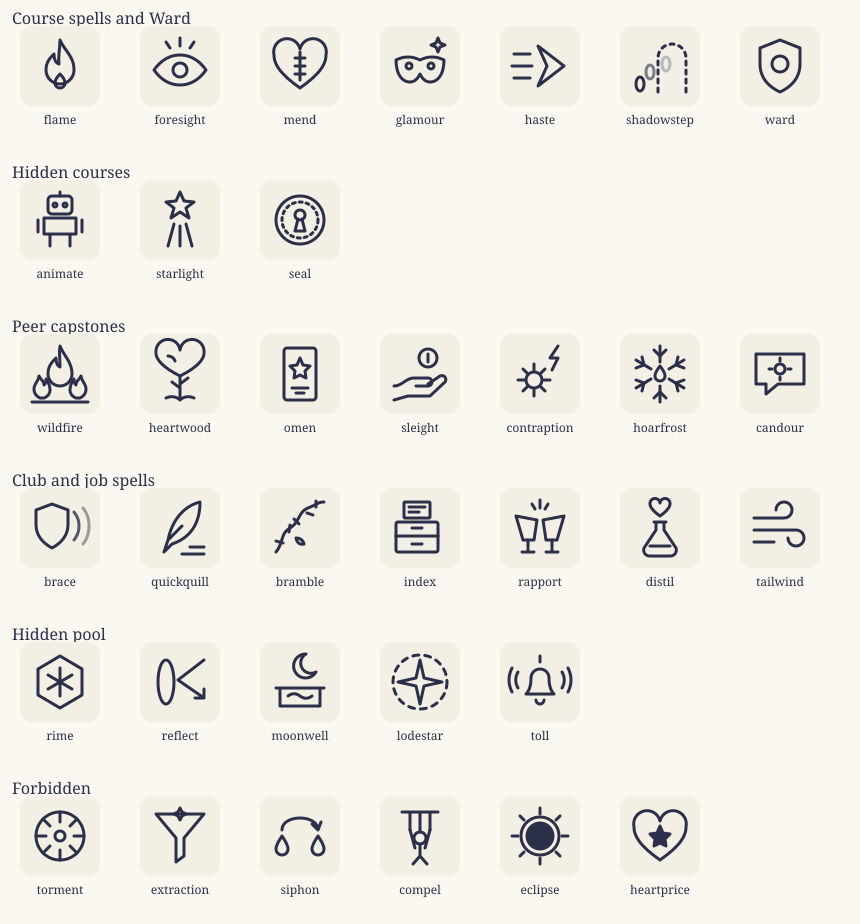
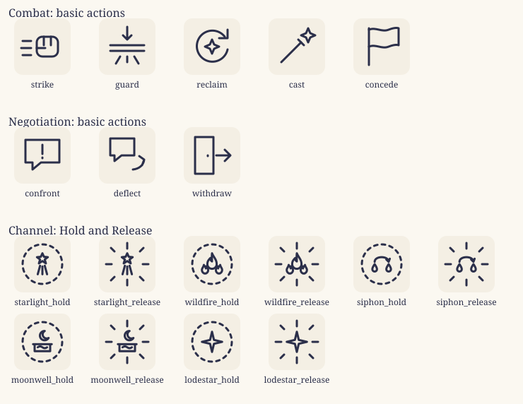

# Spell and action icons (spell redesign v2)

One icon for each of the 35 spells in `docs/spells-v2-list.md`: the 24 sourced spells, the hidden pool and the forbidden pool.

They follow the house style of `src/art.js`:
- a 64×64 viewBox;
- stroke only, width 3, round caps and joins, drawn in `currentColor`, so they take the tint of the chip or card they sit on.

A few deliberate exceptions:
- **Fills:** Eclipse's dark disc and the star in Heartprice use `fill="currentColor"`.
- **Dashes:** Shadowstep's fading footprints, Seal's inner ring and Lodestar's gathering ring.
- **Opacity:** Brace's lingering arcs and Shadowstep's fading footprints.

Each icon is a file in `docs/spell-icons/<id>.svg`. All of them are on one sheet: [`docs/spell-icons/_sheet.svg`](spell-icons/_sheet.svg).

**Wiring them in later** (not done here; this pass changes no code):
1. Add each entry below to `ICONS` in `src/art.js` under its `spell_<id>` key. The prefix keeps them apart from the event icons of the same name, such as `flame` and `shield`.
2. Set the spell's `art:` in `content/world/spells.grim` to that key.

## What each icon shows

**Course spells and Ward**
- **Flame:** a flame with a second, smaller flame at its heart: the duellist's first spell.
- **Foresight:** an open eye with rays above it, looking ahead.
- **Mend:** a heart stitched down the middle ("teacups first, hearts take longer").
- **Glamour:** a masquerade mask with a sparkle.
- **Haste:** a chevron with speed lines.
- **Shadowstep:** footprints fading into a dashed doorway.
- **Ward:** a shield with a single ring, the pale shell from the safety talk.

**Hidden courses**
- **Animate:** a small clockwork figure with an antenna.
- **Starlight:** a star with a beam falling from it.
- **Seal:** a wax seal with a keyhole, ringed in dashes.

**Peer capstones**
- **Wildfire (Lyra):** one great flame with two smaller ones catching beside it on the ground line.
- **Heartwood (Tobias):** a tree whose crown is a heart, with roots.
- **Omen (Seraphine):** a tarot card bearing the Star.
- **Sleight (Corvin):** an open hand under a coin.
- **Contraption (Mir):** a cog throwing a spark.
- **Hoarfrost (Kael):** frost closing around a small flame.
- **Candour (Nessa):** a speech bubble with a small sun in it: the honest answer.

**Club and job spells**
- **Brace (Duelling Circle):** a shield with two fading arcs behind it, the lingering guard.
- **Quickquill (Lumen Ledger):** a quill above lines of fresh writing.
- **Bramble (Verdant Circle):** a thorny vine with one leaf.
- **Index (Library Assistant):** a catalogue drawer with its card pulled up.
- **Rapport (Gilded Newt):** two raised cups and a spark between them.
- **Distil (Apothecary Clerk):** a heart dripping into a flask (Health into Mana).
- **Tailwind (Broom Courier):** curling gusts.

**Hidden pool**
- **Rime:** a snowflake set inside a hexagon of ice (frozen instead of falling).
- **Reflect:** a mirror with a line bouncing off it.
- **Moonwell:** a crescent moon over a well with a ripple.
- **Lodestar:** a four-point star in a gathering, dashed ring.
- **Toll:** a bell sounding.

**Forbidden**
- **Torment:** a ring with its spikes turned inward.
- **Extraction:** a funnel drawing a spark down.
- **Siphon:** a drop drawn across into another drop.
- **Compel:** a marionette on its cross.
- **Eclipse:** a black sun with its corona.
- **Heartprice:** a heart with a dark star inside.

**Creatures** (F5.11: special foes only; each is its own file, read by `combat/web/icon-source.mjs`. The sheet and the
Markup table below predate them.)
- **Gore:** a stag's head, antlers forward.
- **Nip:** a small snout snapping, with speed marks.
- **Filch:** a paw closing on a spark.
- **Roar:** an open mouth with sound rings.
- **Swarm:** a scatter of small bodies.
- **Pinch:** two closing pincers.
- **Acorns:** two acorns, falling.
- **Root:** a root heaving out of the ground and coiling.
- **Web:** an orb web.
- **Threads:** loose sticky strands.
- **Venom:** two fangs and a drop.
- **Skitter:** a small body darting along a dashed trail.
- **Fade:** a stag stepping into a dashed doorway, a second one fading.
- **Burrow:** a mound over the ground line.
- **Hide:** a quilled hump.
- **Bark:** a shield of bark grain.
- **Carapace:** a beetle's split shell.
- **Maul:** a raised paw over a dashed landing line.
- **Charge:** a charging beetle with speed lines.
- **Bough:** a swinging branch on a dashed arc.
- **Slow Fall:** a trunk leaning along a dashed fall.
- **The Long Wait:** a web with a still spider at its heart.
- **Brood:** a large spider over three small ones.
- **Thicket:** three thorned saplings.

## Markup

### Course spells and Ward

| Icon | Key | Inner markup (64×64, for `ICONS` in `src/art.js`) |
|---|---|---|
|  | `spell_flame` | `<path d="M32 6c4 10 14 16 14 30a14 14 0 0 1-28 0c0-8 4-12 8-16 0 6 2 9 5 10-1-8 1-16 1-24z"/><path d="M32 40c3 3 5 6 5 9a5 5 0 0 1-10 0c0-3 2-6 5-9z"/>` |
|  | `spell_foresight` | `<path d="M6 36c7-10 16-15 26-15s19 5 26 15c-7 10-16 15-26 15S13 46 6 36z"/><circle cx="32" cy="36" r="7"/><path d="M32 4v8 M18 8l4 6 M46 8l-4 6"/>` |
|  | `spell_mend` | `<path d="M32 54C12 40 6 30 6 21a12 12 0 0 1 26-6 12 12 0 0 1 26 6c0 9-6 19-26 33z"/><path d="M32 18v28 M27 24h10 M27 32h10 M27 40h10"/>` |
|  | `spell_glamour` | `<path d="M8 26c8-4 16-4 24 0 8-4 16-4 24 0 0 14-6 22-14 22-5 0-8-4-10-8-2 4-5 8-10 8-8 0-14-8-14-22z"/><circle cx="21" cy="32" r="3"/><circle cx="43" cy="32" r="3"/><path d="M50 4l2 5 5 2-5 2-2 5-2-5-5-2 5-2z"/>` |
|  | `spell_haste` | `<path d="M6 20h16 M4 32h20 M6 44h16"/><path d="M30 12l26 20-26 20 9-20z"/>` |
|  | `spell_shadowstep` | `<path d="M30 58V24a14 14 0 0 1 28 0v34" stroke-dasharray="4 5"/><ellipse cx="12" cy="50" rx="4" ry="7"/><ellipse cx="22" cy="38" rx="4" ry="7" opacity="0.6"/><ellipse cx="38" cy="30" rx="4" ry="7" opacity="0.3"/>` |
|  | `spell_ward` | `<path d="M32 6l20 8v16c0 14-9 23-20 28C21 53 12 44 12 30V14z"/><circle cx="32" cy="30" r="8"/>` |

### Hidden courses

| Icon | Key | Inner markup (64×64, for `ICONS` in `src/art.js`) |
|---|---|---|
|  | `spell_animate` | `<rect x="20" y="8" width="24" height="18" rx="4"/><circle cx="27" cy="17" r="2"/><circle cx="37" cy="17" r="2"/><path d="M32 4v4 M16 30h32v16H16z M22 46v12 M42 46v12 M10 32v12 M54 32v12"/>` |
|  | `spell_starlight` | `<path d="M32 4l4 9 10 1-8 6 3 10-9-6-9 6 3-10-8-6 10-1z"/><path d="M26 36l-6 22 M38 36l6 22 M32 38v20"/>` |
|  | `spell_seal` | `<circle cx="32" cy="32" r="24"/><circle cx="32" cy="32" r="18" stroke-dasharray="3 4"/><circle cx="32" cy="27" r="5"/><path d="M30 31l-3 12h10l-3-12"/>` |

### Peer capstones

| Icon | Key | Inner markup (64×64, for `ICONS` in `src/art.js`) |
|---|---|---|
|  | `spell_wildfire` | `<path d="M32 4c4 10 12 16 12 28a12 12 0 0 1-24 0c0-8 4-12 8-16 0 6 2 8 4 9 0-8-1-14 0-21z"/><path d="M12 56c-4-2-6-5-6-9 0-5 4-7 5-13 2 4 5 5 5 9 2-2 2-4 2-6 3 4 4 8 4 11 0 4-3 7-6 8z M52 56c4-2 6-5 6-9 0-5-4-7-5-13-2 4-5 5-5 9-2-2-2-4-2-6-3 4-4 8-4 11 0 4 3 7 6 8z"/><path d="M4 60h56"/>` |
|  | `spell_heartwood` | `<path d="M32 58V34 M32 46l-8-6 M32 42l8-6 M32 58c-4-4-10-4-14-2 M32 58c4-4 10-4 14-2"/><path d="M32 34C16 26 8 18 8 11a9 9 0 0 1 24-3 9 9 0 0 1 24 3c0 7-8 15-24 23z"/><path d="M20 14c3 0 6 2 7 5"/>` |
|  | `spell_omen` | `<rect x="16" y="6" width="32" height="52" rx="3"/><path d="M32 16l3 7 7 1-5 5 1 7-6-3-6 3 1-7-5-5 7-1z"/><path d="M24 46h16 M28 51h8"/>` |
|  | `spell_sleight` | `<path d="M6 44c8 0 12-8 20-8h14a4 4 0 0 1 0 8H28"/><path d="M40 42l12-8a4 4 0 0 1 5 6L42 54H20l-14 4"/><circle cx="40" cy="16" r="9"/><path d="M40 12v8"/>` |
|  | `spell_contraption` | `<circle cx="26" cy="38" r="8"/><path d="M26 22v6 M26 48v6 M10 38h6 M36 38h6 M15 27l4 4 M33 45l4 4 M15 49l4-4 M33 31l4-4"/><path d="M50 4l-8 12h8l-6 12"/>` |
|  | `spell_hoarfrost` | `<path d="M32 4v16 M32 44v16 M8 18l15 9 M56 46l-15-9 M8 46l15-9 M56 18l-15 9"/><path d="M26 8l6 6 6-6 M26 56l6-6 6 6 M8 26l8-3-2-8 M56 38l-8 3 2 8 M8 38l8 3-2 8 M56 26l-8-3 2-8"/><path d="M32 24c3 4 5 7 5 10a5 5 0 0 1-10 0c0-3 2-6 5-10z"/>` |
|  | `spell_candour` | `<path d="M8 12h48v30H30l-12 10V42H8z"/><circle cx="32" cy="27" r="5"/><path d="M32 16v3 M32 35v3 M21 27h3 M40 27h3"/>` |

### Club and job spells

| Icon | Key | Inner markup (64×64, for `ICONS` in `src/art.js`) |
|---|---|---|
|  | `spell_brace` | `<path d="M24 8l16 6v14c0 12-7 19-16 24C15 47 8 40 8 28V14z"/><path d="M46 16c3 4 5 8 5 14s-2 10-5 14" opacity="0.8"/><path d="M55 12c4 5 6 11 6 18s-2 13-6 18" opacity="0.45"/>` |
|  | `spell_quickquill` | `<path d="M52 6C36 10 24 24 20 44l-4 12 8-8c18-6 28-20 28-42z M20 44l14-14"/><path d="M34 58h22 M42 51h14"/>` |
|  | `spell_bramble` | `<path d="M8 56c8-10 4-18 14-24s8-16 18-20 10-6 16-6"/><path d="M15 47l-7-2 M21 36l1-7 M31 28l-5-5 M39 17l6 2 M48 11V5"/><path d="M28 42c4 0 7 2 8 6-4 1-7-1-8-6z"/>` |
|  | `spell_index` | `<rect x="8" y="26" width="42" height="30" rx="2"/><path d="M8 40h42 M24 32h10 M24 48h10"/><rect x="16" y="6" width="26" height="16" rx="1"/><path d="M21 11h16 M21 16h10"/>` |
|  | `spell_rapport` | `<path d="M8 20l7 24h11l3-20z M56 20l-7 24H38l-3-20z"/><path d="M20 44v10 M44 44v10 M14 56h12 M38 56h12"/><path d="M32 4v8 M24 8l3 5 M40 8l-3 5"/>` |
|  | `spell_distil` | `<path d="M26 26h12 M28 26v8L16 52a6 6 0 0 0 5 8h22a6 6 0 0 0 5-8L36 34v-8"/><path d="M32 20C25 15 22 11 22 8a5 5 0 0 1 10-1 5 5 0 0 1 10 1c0 3-3 7-10 12z"/><path d="M22 50h20"/>` |
|  | `spell_tailwind` | `<path d="M6 22h30a8 8 0 1 0-8-8 M6 34h42a8 8 0 1 1-8 8 M6 46h20"/>` |

### Hidden pool

| Icon | Key | Inner markup (64×64, for `ICONS` in `src/art.js`) |
|---|---|---|
|  | `spell_rime` | `<path d="M32 6l22 13v26L32 58 10 45V19z"/><path d="M32 18v28 M20 25l24 14 M20 39l24-14"/>` |
|  | `spell_reflect` | `<ellipse cx="18" cy="32" rx="8" ry="22"/><path d="M56 10L30 30 M30 30l26 18 M56 48h-9 M56 48v-9"/>` |
|  | `spell_moonwell` | `<path d="M38 4a12 12 0 1 0 10 18A10 10 0 0 1 38 4z"/><path d="M8 38h48 M12 38v18h40V38 M20 46c4-3 8-3 12 0s8 3 12 0"/>` |
|  | `spell_lodestar` | `<path d="M32 10l4 18 18 4-18 4-4 18-4-18-18-4 18-4z"/><circle cx="32" cy="32" r="27" stroke-dasharray="6 6"/>` |
|  | `spell_toll` | `<path d="M18 44h28c-3-3-5-8-5-16a9 9 0 0 0-18 0c0 8-2 13-5 16z M28 50a4 4 0 0 0 8 0 M32 12V6"/><path d="M10 22c-3 5-3 11 0 16 M54 22c3 5 3 11 0 16 M4 18c-4 8-4 16 0 24 M60 18c4 8 4 16 0 24"/>` |

### Forbidden

| Icon | Key | Inner markup (64×64, for `ICONS` in `src/art.js`) |
|---|---|---|
|  | `spell_torment` | `<circle cx="32" cy="32" r="24"/><path d="M32 8v10 M32 56V46 M8 32h10 M56 32H46 M15 15l7 7 M49 49l-7-7 M15 49l7-7 M49 15l-7 7"/><circle cx="32" cy="32" r="5"/>` |
|  | `spell_extraction` | `<path d="M8 10h48L36 34v18l-8 6V34z"/><path d="M32 2l2 4 4 2-4 2-2 4-2-4-4-2 4-2z" transform="translate(0 2)"/>` |
|  | `spell_siphon` | `<path d="M14 32c4 6 6 10 6 13a6 6 0 0 1-12 0c0-3 2-7 6-13z M50 32c4 6 6 10 6 13a6 6 0 0 1-12 0c0-3 2-7 6-13z"/><path d="M14 26c0-16 36-16 36 0 M44 20l6 6 3-8"/>` |
|  | `spell_compel` | `<path d="M14 8h36 M22 8v18 M42 8v18 M32 8v20"/><circle cx="32" cy="34" r="6"/><path d="M32 40v12 M22 26l5 18 M42 26l-5 18 M25 60l7-8 7 8"/>` |
|  | `spell_eclipse` | `<circle cx="32" cy="32" r="13" fill="currentColor"/><circle cx="32" cy="32" r="19"/><path d="M32 4v6 M32 54v6 M4 32h6 M54 32h6 M12 12l4 4 M48 48l4 4 M12 52l4-4 M48 16l4-4"/>` |
|  | `spell_heartprice` | `<path d="M32 56C12 42 6 32 6 23a12 12 0 0 1 26-6 12 12 0 0 1 26 6c0 9-6 19-26 33z"/><path d="M32 22l3 7 7 1-5 5 1 7-6-3-6 3 1-7-5-5 7-1z" fill="currentColor"/>` |

# Action icons

The buttons a player presses in the minigames that aren't spells:
- the basic actions of combat v2 and negotiation v3;
- the two channelling actions, **Hold** and **Release**, for each channelled spell (Starlight, Wildfire, Siphon, Moonwell, Lodestar).

Starting a channel is the spell's own cast, so it uses the spell icon above.

They follow the same house style as the spell icons. They are in `docs/action-icons/<id>.svg`, with a sheet at [`docs/action-icons/_sheet.svg`](action-icons/_sheet.svg). Their keys use the prefix `act_`.

## What each icon shows

**Combat**
- **Strike:** a fist with speed lines. A plain blow, nothing magical.
- **Guard:** a two-bar barrier with an arrow stopped against it, splinters falling. It's different from Ward's shield on purpose: Guard is a stance, Ward is a spell.
- **Reclaim:** a sparkle inside a turning arrow, spent magic coming back.
- **Cast:** a wand with a sparkle, for a generic "cast a spell" button or the spell menu.
- **Concede:** a flag, the separate "leave the fight" control.

**Negotiation**
- **Confront:** a speech bubble with an exclamation mark.
- **Deflect:** a speech bubble with an arrow curving away from it.
- **Withdraw:** a door with an exit arrow, the leave control (Shadowstep's spell icon is the magical way out).

**Channelling.** Every channelled spell uses one grammar, so the player learns it once:
- **Hold:** the spell's motif, small, inside a **dashed ring**: power gathered and kept in.
- **Release:** the same motif with **eight rays bursting outward** and no ring: the power let go.

The motif is the spell's own icon shrunk to 55%, with its stroke thickened so it still draws at width 3. Lodestar's motif drops its own dashed ring, so as not to double the Hold ring.

## Markup

### Combat: basic actions

| Icon | Key | Inner markup |
|---|---|---|
|  | `act_strike` | `<rect x="24" y="18" width="30" height="28" rx="8"/><path d="M34 18v12 M44 18v12 M24 34h12"/><path d="M4 24h12 M2 34h14 M4 44h12"/>` |
|  | `act_guard` | `<path d="M8 30h48 M8 38h48"/><path d="M32 4v18 M26 16l6 6 6-6"/><path d="M22 46l-6 10 M42 46l6 10 M32 46v8"/>` |
|  | `act_reclaim` | `<path d="M50 18a22 22 0 1 0 4 18"/><path d="M54 8v12H42"/><path d="M32 22l3 7 7 3-7 3-3 7-3-7-7-3 7-3z"/>` |
|  | `act_cast` | `<path d="M10 54L38 26"/><path d="M34 22l8 8"/><path d="M48 6l3 7 7 3-7 3-3 7-3-7-7-3 7-3z"/>` |
|  | `act_concede` | `<path d="M14 58V6"/><path d="M14 8c10-4 18 4 28 0s14-2 14-2v24s-4-2-14 2-18-4-28 0"/>` |

### Negotiation: basic actions

| Icon | Key | Inner markup |
|---|---|---|
|  | `act_confront` | `<path d="M8 10h48v32H30l-12 10V42H8z"/><path d="M32 17v13 M32 35v1"/>` |
|  | `act_deflect` | `<path d="M8 8h34v24H24l-10 8v-8H8z"/><path d="M40 52c9-1 15-6 16-14 M49 33l7 5-3 8"/>` |
|  | `act_withdraw` | `<path d="M8 6h26v52H8z M26 32v1"/><path d="M38 32h20 M50 24l8 8-8 8"/>` |

### Channel: Hold and Release

| Icon | Key | Inner markup |
|---|---|---|
|  | `act_starlight_hold` | `<circle cx="32" cy="32" r="28" stroke-dasharray="5 6"/><g transform="translate(32 32) scale(0.55) translate(-32 -32)" stroke-width="5.5"><path d="M32 4l4 9 10 1-8 6 3 10-9-6-9 6 3-10-8-6 10-1z"/><path d="M26 36l-6 22 M38 36l6 22 M32 38v20"/></g>` |
|  | `act_starlight_release` | `<path d="M32 2v8 M32 54v8 M2 32h8 M54 32h8 M9 9l5 5 M50 50l5 5 M9 55l5-5 M50 14l5-5"/><g transform="translate(32 32) scale(0.55) translate(-32 -32)" stroke-width="5.5"><path d="M32 4l4 9 10 1-8 6 3 10-9-6-9 6 3-10-8-6 10-1z"/><path d="M26 36l-6 22 M38 36l6 22 M32 38v20"/></g>` |
|  | `act_wildfire_hold` | `<circle cx="32" cy="32" r="28" stroke-dasharray="5 6"/><g transform="translate(32 32) scale(0.55) translate(-32 -32)" stroke-width="5.5"><path d="M32 4c4 10 12 16 12 28a12 12 0 0 1-24 0c0-8 4-12 8-16 0 6 2 8 4 9 0-8-1-14 0-21z"/><path d="M12 56c-4-2-6-5-6-9 0-5 4-7 5-13 2 4 5 5 5 9 2-2 2-4 2-6 3 4 4 8 4 11 0 4-3 7-6 8z M52 56c4-2 6-5 6-9 0-5-4-7-5-13-2 4-5 5-5 9-2-2-2-4-2-6-3 4-4 8-4 11 0 4 3 7 6 8z"/></g>` |
|  | `act_wildfire_release` | `<path d="M32 2v8 M32 54v8 M2 32h8 M54 32h8 M9 9l5 5 M50 50l5 5 M9 55l5-5 M50 14l5-5"/><g transform="translate(32 32) scale(0.55) translate(-32 -32)" stroke-width="5.5"><path d="M32 4c4 10 12 16 12 28a12 12 0 0 1-24 0c0-8 4-12 8-16 0 6 2 8 4 9 0-8-1-14 0-21z"/><path d="M12 56c-4-2-6-5-6-9 0-5 4-7 5-13 2 4 5 5 5 9 2-2 2-4 2-6 3 4 4 8 4 11 0 4-3 7-6 8z M52 56c4-2 6-5 6-9 0-5-4-7-5-13-2 4-5 5-5 9-2-2-2-4-2-6-3 4-4 8-4 11 0 4 3 7 6 8z"/></g>` |
|  | `act_siphon_hold` | `<circle cx="32" cy="32" r="28" stroke-dasharray="5 6"/><g transform="translate(32 32) scale(0.55) translate(-32 -32)" stroke-width="5.5"><path d="M14 32c4 6 6 10 6 13a6 6 0 0 1-12 0c0-3 2-7 6-13z M50 32c4 6 6 10 6 13a6 6 0 0 1-12 0c0-3 2-7 6-13z"/><path d="M14 26c0-16 36-16 36 0 M44 20l6 6 3-8"/></g>` |
|  | `act_siphon_release` | `<path d="M32 2v8 M32 54v8 M2 32h8 M54 32h8 M9 9l5 5 M50 50l5 5 M9 55l5-5 M50 14l5-5"/><g transform="translate(32 32) scale(0.55) translate(-32 -32)" stroke-width="5.5"><path d="M14 32c4 6 6 10 6 13a6 6 0 0 1-12 0c0-3 2-7 6-13z M50 32c4 6 6 10 6 13a6 6 0 0 1-12 0c0-3 2-7 6-13z"/><path d="M14 26c0-16 36-16 36 0 M44 20l6 6 3-8"/></g>` |
|  | `act_moonwell_hold` | `<circle cx="32" cy="32" r="28" stroke-dasharray="5 6"/><g transform="translate(32 32) scale(0.55) translate(-32 -32)" stroke-width="5.5"><path d="M38 4a12 12 0 1 0 10 18A10 10 0 0 1 38 4z"/><path d="M8 38h48 M12 38v18h40V38 M20 46c4-3 8-3 12 0s8 3 12 0"/></g>` |
|  | `act_moonwell_release` | `<path d="M32 2v8 M32 54v8 M2 32h8 M54 32h8 M9 9l5 5 M50 50l5 5 M9 55l5-5 M50 14l5-5"/><g transform="translate(32 32) scale(0.55) translate(-32 -32)" stroke-width="5.5"><path d="M38 4a12 12 0 1 0 10 18A10 10 0 0 1 38 4z"/><path d="M8 38h48 M12 38v18h40V38 M20 46c4-3 8-3 12 0s8 3 12 0"/></g>` |
|  | `act_lodestar_hold` | `<circle cx="32" cy="32" r="28" stroke-dasharray="5 6"/><g transform="translate(32 32) scale(0.55) translate(-32 -32)" stroke-width="5.5"><path d="M32 6l5 21 21 5-21 5-5 21-5-21-21-5 21-5z"/></g>` |
|  | `act_lodestar_release` | `<path d="M32 2v8 M32 54v8 M2 32h8 M54 32h8 M9 9l5 5 M50 50l5 5 M9 55l5-5 M50 14l5-5"/><g transform="translate(32 32) scale(0.55) translate(-32 -32)" stroke-width="5.5"><path d="M32 6l5 21 21 5-21 5-5 21-5-21-21-5 21-5z"/></g>` |
